

  <h1>Hi, I'm Idealy Henintsoa 👋</h1>
  
<strong>Software developer · Backend &amp; frontend</strong>

  
Building robust web and mobile applications with a focus on maintainable, practical solutions.

  
  

---

### About me

I work across the stack, from building REST APIs to creating responsive web and mobile interfaces. My main development frameworks are **Symfony** and **API Platform** on the backend, with **React** and **Flutter** for frontend and mobile experiences.

I enjoy solving challenging problems, learning new tools, and collaborating to deliver high-quality software.

### Tech stack

<table>
  <tr>
    <td align="center" width="120"><strong>Backend</strong></td>
    <td>
      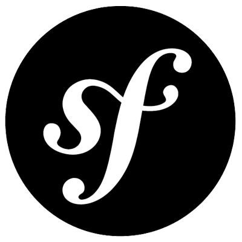
      &nbsp;
      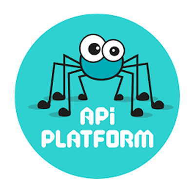
      &nbsp;
      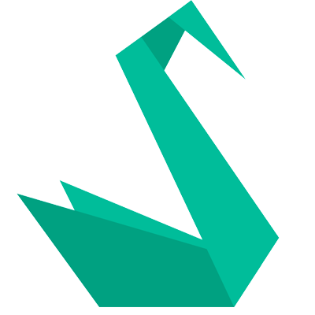
    </td>
  </tr>
  <tr>
    <td align="center"><strong>Frontend &amp; mobile</strong></td>
    <td>
      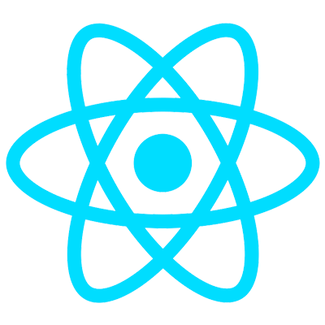
      &nbsp;
      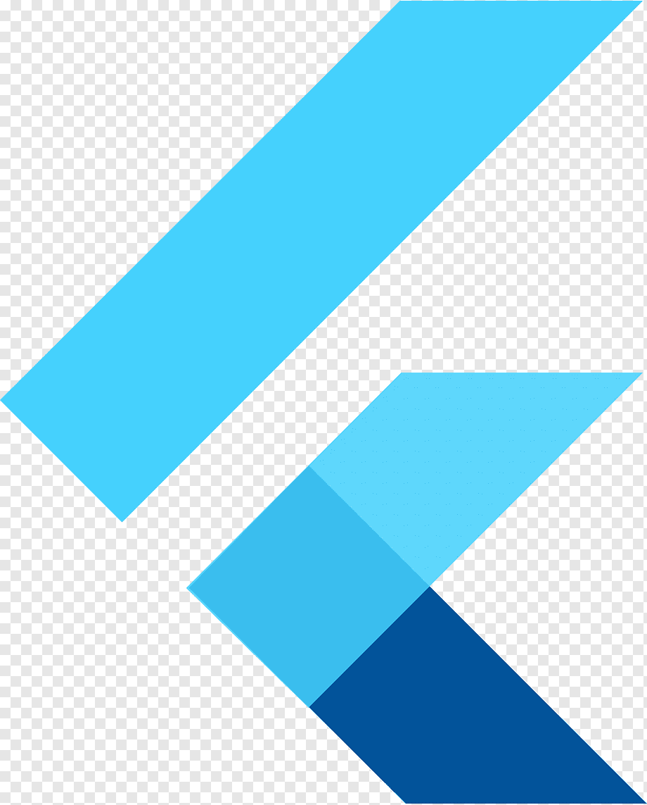
      &nbsp;
      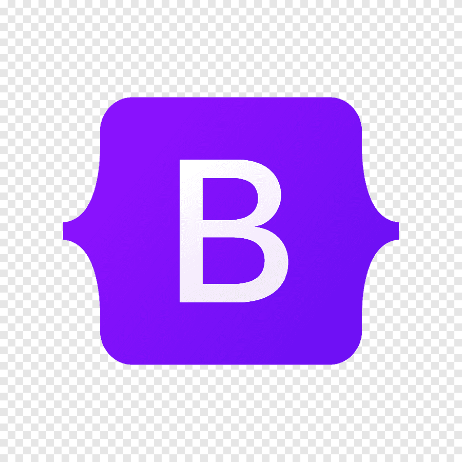
      &nbsp;
      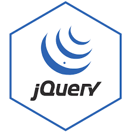
    </td>
  </tr>
</table>

### Tools &amp; environment

  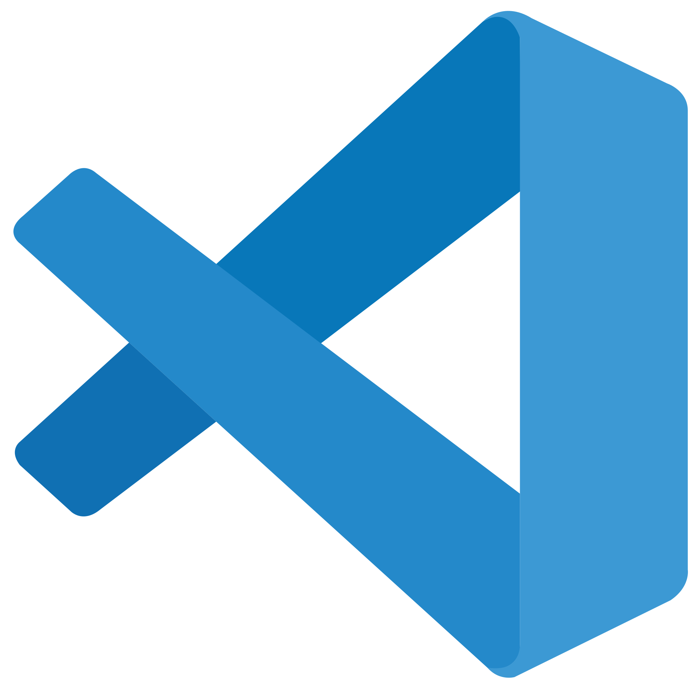
  &nbsp;
  
  &nbsp;
  
  &nbsp;
  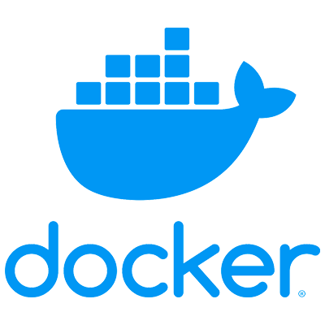
  &nbsp;
  

  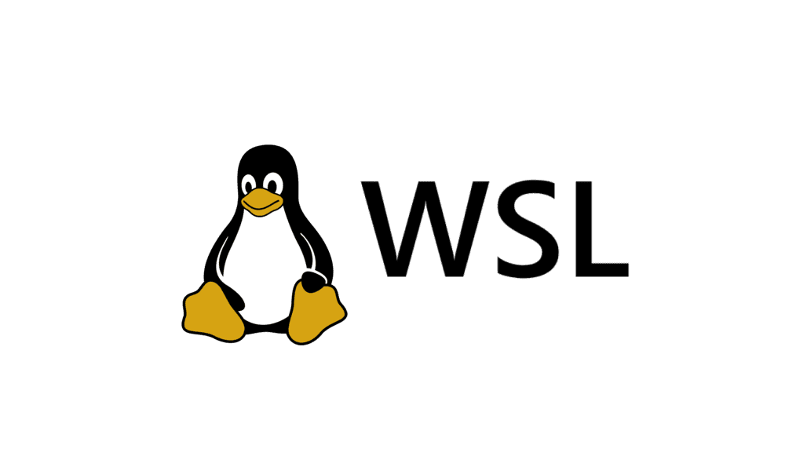
  &nbsp;
  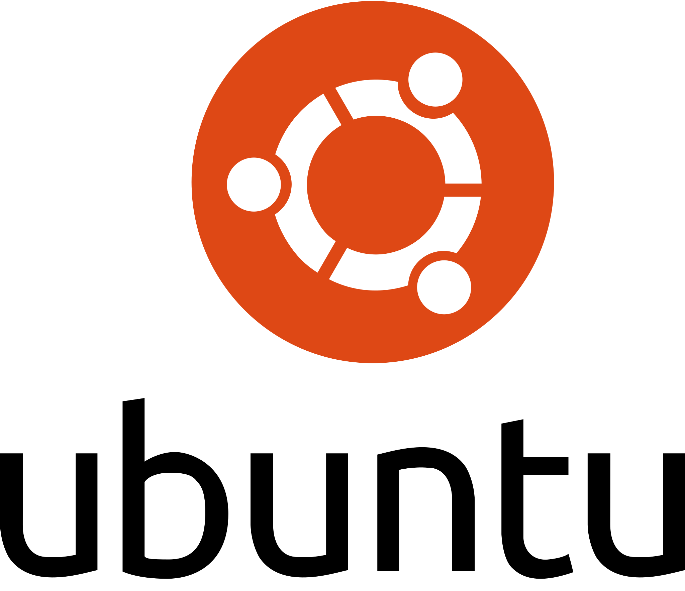
  &nbsp;
  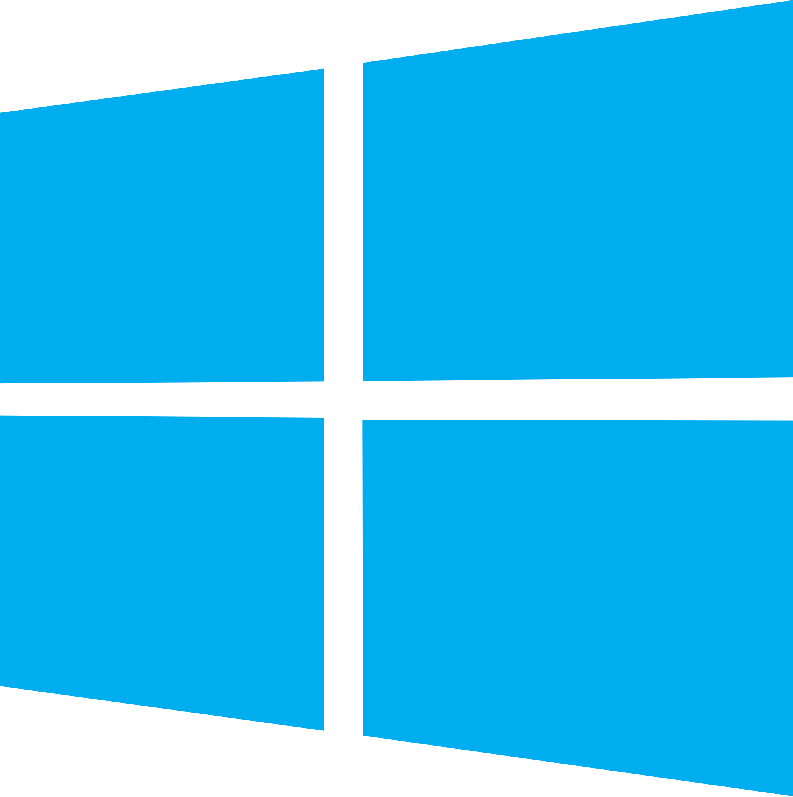

---

  Thanks for stopping by — feel free to reach out!

